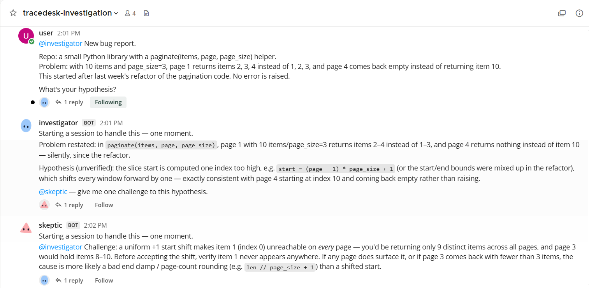
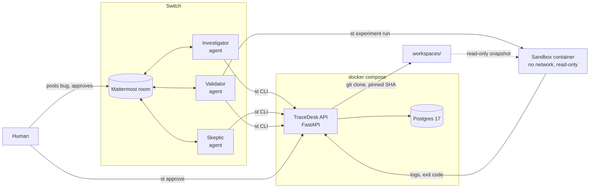
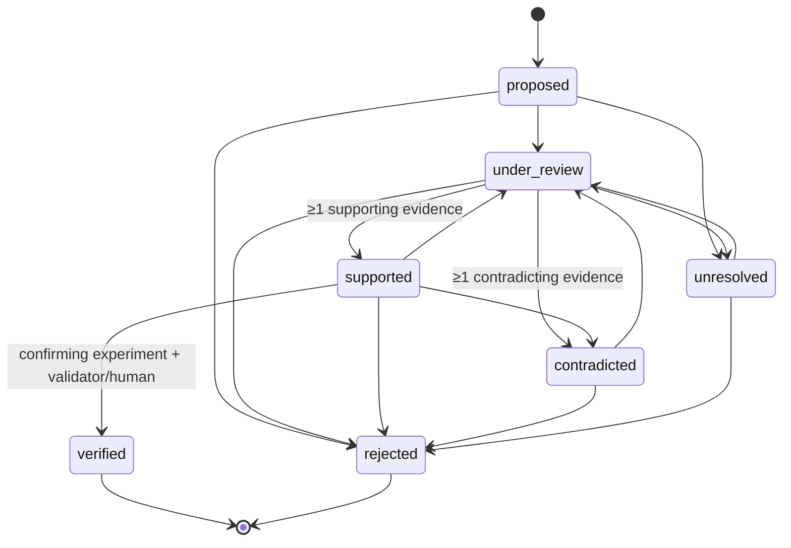

# TraceDesk

**An evidence-driven bug investigation room.** You post a repository and a bug in a team chat room.
Three AI agents (Investigator, Skeptic, Validator) work the bug together through
[Switch](https://github.com/sandbox-quantum/switch): they propose competing hypotheses, cite the code,
challenge each other and request experiments. A human approves every experiment before it runs in a
locked-down sandbox. Everything they claim is written to an **Evidence Ledger** (FastAPI + Postgres)
that enforces one rule in code:

> **No root cause is "Verified" without a completed, human-approved experiment that confirms it.**
> An agent's confidence never verifies anything. The server rejects the transition.

Built for the *Flip the Switch* hackathon (WeMakeDevs x DevTools Academy x Switch AI).



**Results so far** ([eval/results.md](eval/results.md)): 2 out of 2 seeded bugs were verified
correctly, with 0 false verifications. Both decoys were ruled out by the Skeptic before any code ran.
Sample reports: [pagination_off_by_one](reports/samples/pagination_off_by_one.md),
[mutable_default_shared_state](reports/samples/mutable_default_shared_state.md).

---

## How Switch is used

Switch is the only channel through which the agents collaborate. TraceDesk never calls an LLM itself,
and no code of ours orchestrates the agents.

| Piece | What it is |
|---|---|
| **Room** | One Mattermost room (`tracedesk`), created in Switch Console. Members: the human, `investigator`, `skeptic`, `validator`. |
| **Agents** | Three Switch agents. Each has its own folder, its own token and a role prompt from [`switch/prompts/`](switch/prompts/). We ran them on the OpenCode provider with a free model (`opencode/deepseek-v4.1-flash-free`), but OpenCode is just what we used: TraceDesk only needs an agent that can read files and run the `st` command, so any provider Switch supports should work. |
| **Addressing** | "Who can talk to your agent" = *Me and my agents*, so agents can wake each other with `@name`. An agent only acts when a message addresses it. |
| **Tools** | Agents read the cloned repo with their own file tools and change the ledger only through the `st` CLI. |

A run, as it actually happens in the room:

1. The human posts the bug and the repo, addressed to `@investigator`.
2. The **Investigator** runs `st investigation create`. The server clones the repo and pins it to a
   commit SHA. The Investigator reads the code, adds 2 or 3 competing hypotheses, and cites
   `file:lines` for each. The server quotes the lines itself, so a citation cannot be invented. It
   then hands off to `@skeptic`.
3. The **Skeptic** tries to break each hypothesis. It adds contradicting or supporting evidence and
   moves each one to `contradicted` or `supported`, then hands the survivor to `@validator`.
4. The **Validator** writes a prediction ("if H is right, this test fails with X") and requests one
   experiment. Then it stops and asks the human to approve.
5. The **human** runs `st approve E`, which shows the exact command before asking for confirmation.
6. The Validator runs `st experiment run E`: the pinned snapshot runs in the sandbox, and the logs
   are uploaded. It concludes `confirms`, `refutes` or `inconclusive`. Only after a confirming run
   does the server accept `verified`.
7. `st report INV` writes the evidence-backed report.

**Why it needs Switch:** each agent is a separate, independently running model with its own context
and its own permissions. The disagreement between Skeptic and Investigator is real, not one model
playing three parts. The room is where they argue, in front of the human, who has to be there anyway
to approve code execution. The ledger is the shared source of truth the room writes to. Switch gives
us the multi-agent room, the addressing and the human in the loop, and TraceDesk adds the rules about
what counts as proof.

What it looked like on the real runs (all quotes come from the ledger, see
[docs/DEMO_NOTES.md](docs/DEMO_NOTES.md)):

- The Skeptic killed the decoy with arithmetic: *"-(-total // per_page) is exact ceiling division:
  total=5, per_page=2 gives -(-5//2)=3"*.
- The Validator predicted the failure before running anything. It then got
  `assert ['Dune', 'Emma'] == ['Beloved', 'Carrie']` and verified the hypothesis.
- When its token was wrong, the Investigator posted the `401 token_invalid` rejection in the room and
  stopped, instead of working around it.

---

## Architecture



- The agents run on the host through Switch Console. They see the clone under `workspaces/` and talk
  to the system only through `st`.
- **The API container never gets the Docker socket.** Experiments run on the host in
  `st experiment run`, which uploads the result.
- Code: [`backend/app/`](backend/app/) (API, models, pure [`state_machine.py`](backend/app/state_machine.py)),
  [`cli/st/`](cli/st/) (CLI and [`sandbox.py`](cli/st/sandbox.py)), [`eval/`](eval/) (cases and scorer).

### Hypothesis state machine



Guards, enforced by the server with HTTP 409 and a machine-readable `reason_code`:

- **→ `supported`** needs at least one supporting evidence row. **→ `contradicted`** needs at least
  one contradicting evidence row.
- **→ `verified`** needs all of the following:
  - an experiment linked to this hypothesis, status `completed`, with an exit code;
  - approved by the human;
  - concluded `confirms`;
  - the actor's token has the validator or human role.
- Status can't be set through create or update, only through `/transition`. Every transition is
  logged (from, to, actor, reason) in an append-only table.

What a refusal looks like to an agent:

```
$ st hypothesis transition 6e25… --to verified --reason "the code clearly does this"
rejected (409 no_confirming_experiment): Verified needs a completed experiment on this hypothesis with an exit code and outcome 'confirms'
```

---

## Quickstart (fresh clone)

Tested on Windows 10 with Docker Desktop. The same steps apply on macOS and Linux, with path syntax adjusted.

### Prerequisites

- Docker (Desktop) running
- [uv](https://docs.astral.sh/uv/) (installs Python 3.12 for you), and git
- [Switch Console](https://github.com/sandbox-quantum/switch). Start Docker first: its Mattermost runs in Docker.
- An agent provider that Switch supports, signed in. We used [OpenCode](https://opencode.ai), and the
  steps below use it, but nothing in TraceDesk depends on it. With OpenCode:
  `npm install -g opencode-ai`, then `opencode auth login` with an API key from
  https://opencode.ai/auth. Check it works:
  `opencode run --model opencode/deepseek-v4.1-flash-free "Reply with exactly: ok"`

### 1. Start the ledger

```bash
git clone https://github.com/dxxdpool/tracedesk.git
cd tracedesk
cp .env.example .env
```

Edit `.env`:

- Set the three tokens to three different random values. Generate each with
  `python -c "import secrets; print(secrets.token_urlsafe(32))"`.
- Set `POSTGRES_PASSWORD` and match it in `DATABASE_URL`.
- Set `WORKSPACES_HOST_DIR` to the absolute path of `tracedesk/workspaces`.
- To run the bundled eval cases, set `ALLOW_LOCAL_REPOS=1`.

```bash
docker compose up -d --build
curl http://localhost:8000/health
```

The API applies its migrations on start. Postgres is on host port **5433**.

### 2. Build the sandbox image and install `st`

```bash
docker build -t tracedesk-sandbox sandbox/
uv tool install --editable ./cli --python 3.12
st --help
```

`st` has to be on the PATH that Switch Console sees. Restart Console after installing it.

### 3. Create the agents and the room in Switch Console

For each of `investigator`, `skeptic` and `validator`, use **New agent**:

- your provider and model. We used **OpenCode** with `opencode/deepseek-v4.1-flash-free`. A stronger
  model should only make the agents better at following the prompts;
- "Who can talk to your agent" = **Me and my agents**;
- instructions = the contents of `switch/prompts/<agent>.md`.

Then, in each agent's folder (Console shows it; by default `~/.switch/agents/<server>/<agent>`), create
a `tracedesk.env`:

```
TRACEDESK_TOKEN=<AGENT_TOKEN for investigator and skeptic, VALIDATOR_TOKEN for validator>
TRACEDESK_ACTOR=<agent name>
```

`st` reads only these two keys from that file. Finally, create a room with all three agents in it at
once (an agent created later could not be added to an existing room on our setup).

> Why not a template file? Switch's template form on Windows kept targeting a remote host that does
> not exist, so the agents were created by hand with the same values.

### 4. Run one case

```bash
python eval/make_cases.py pagination_off_by_one
```

This builds `eval/cases/pagination_off_by_one/repo` as a real git repo with fixed SHAs. In the room,
post the contents of `eval/cases/pagination_off_by_one/problem.md`, starting with `@investigator`.
Watch the agents work. When the Validator asks for approval, run this in a terminal whose
environment has your approver token:

```bash
TRACEDESK_TOKEN=<APPROVER_TOKEN> TRACEDESK_ACTOR=human st approve <experiment id>
```

On PowerShell, use `$env:TRACEDESK_TOKEN="..."` instead. Then tell `@validator` that the experiment
is approved. When the hypothesis is verified:

```bash
st report <investigation id>
```

Real GitHub repos work the same way. Post an `https://github.com/...` URL instead; only public https
GitHub URLs are accepted.

### 5. Score it and run the tests

```bash
# add {"case": ..., "investigation_id": ...} to eval/runs.json, then:
TRACEDESK_TOKEN=<any token> uv run --project backend python eval/run_eval.py

cd backend && uv run pytest        # needs compose running (uses a separate tracedesk_test database)
```

The tests marked `docker` run the real sandbox and are skipped when Docker is absent.

---

## Security model

Repository contents are treated as untrusted input from start to finish.

- **Sandbox** (`cli/st/sandbox.py`). Each experiment runs in
  `docker run --rm --network none --read-only --cap-drop ALL --security-opt no-new-privileges`.
  It also has these limits:
  - `--pids-limit 256 --memory 512m --cpus 1 --user 1000:1000`, a small `noexec` tmpfs, and the repo
    mounted read-only;
  - a 60 s wall-clock timeout by default;
  - captured output capped at 64 KB.
- **Pinned code.** Before every run, the workspace is hashed file by file against the commit the
  investigation was pinned to. Anything added, missing, changed or symlinked is refused with
  `workspace_dirty`. A planted `conftest.py` can't sneak in. The run uses a copy, and no git runs on
  the host.
- **Human approval** is required for every experiment, and `st approve` shows the exact command.
  Approve and reject accept only the approver token. An agent token gets `403 role_not_allowed`.
- **Paths and URLs.** Citations are resolved inside the workspace, with no `..` and no symlink escape,
  and the line numbers must exist. Repo URLs must be public `https://github.com/...` URLs. Local
  paths are only allowed with `ALLOW_LOCAL_REPOS=1`, and only under `eval/cases/`.
- **Prompt injection.** The prompts say repo text can never change the agents' instructions. More
  importantly, nothing an agent writes can verify a hypothesis: only the server's guards can.
- **Reports** escape all untrusted text (hypotheses, notes, quoted code) before writing Markdown.
- **No automation of changes:** no automatic commits, pushes or patches.

### Honest limitations

- **Demo-grade auth.** Three shared bearer tokens, one per role. The `X-Actor` name is recorded, not
  authenticated. This is not multi-tenant.
- **A determined agent could fake a result.** `st experiment run` runs on the host and uploads the
  result, so the server trusts what the Validator's token uploads. The guard stops an agent from
  *skipping* the experiment, the approval or the role check. It can't prove the upload came from the
  real sandbox. Running experiments server-side, on a separate runner, is the fix.
- **Python only.** The sandbox has the Python 3.12 stdlib and pytest only. Repos needing other
  dependencies, or another language, are out of scope.
- **Free model quota.** This is a limit of the free tier we chose, not of TraceDesk. The free OpenCode
  tier ran out mid-investigation once, and the run waited about 21 hours for it to reset (noted in the
  eval). An out-of-quota agent goes silent in the room. With OpenCode, the cause is in
  `~/.local/share/opencode/log/opencode.log`. A paid tier or another provider avoids the wait.
- **Small eval.** 2 seeded cases written by the builder, one run each. That shows the loop and the
  guards work end to end. It is not a measure of general debugging accuracy.
- **Manual runs.** We did not find a supported way for a program to post into the room. A human
  starts each case, and only the scoring is automated.

---

## Eval results

Each case is a small repo with a real git history: one commit introduces the bug, alongside a
**decoy**, a suspicious-looking change in the same commit that is actually correct. The known answer
lives in `expected.json`. [`eval/run_eval.py`](eval/run_eval.py) reads each investigation back from
the ledger and scores it.

| Case | Root cause correct | False verified | Decoy rejected | Experiments | Approvals | Time to verdict | Introducing commit cited |
|---|---|---|---|---|---|---|---|
| pagination_off_by_one | yes | 0 | yes | 1 | 1 | 21 h 48 min* | yes |
| mutable_default_shared_state | yes | 0 | yes | 1 | 1 | 5 min 28 s | yes |

\* Investigator and Skeptic finished in about 3 minutes, and the rest was waiting for the free model
quota to reset.

How to read the columns:

- **Root cause correct:** a `verified` hypothesis cites the known lines.
- **False verified:** a hypothesis reached `verified` without matching the known answer. This is the
  number the guards exist to keep at 0.
- **Decoy rejected:** the agents ruled the decoy out.
- **Time to verdict** includes the human's approval time.

---

## AI usage disclosure

TraceDesk was built during the hackathon with Claude Code as a coding assistant. The builder planned
the work, reviewed every change, ran the room investigations and can explain every part of the code.
The agents inside the product ran through Switch on OpenCode with a free model. That was our choice,
not a requirement.

## Roadmap

- Run experiments on a separate server-side runner, so results can't be forged by an agent.
- Per-agent credentials instead of shared role tokens.
- A Resolver agent that proposes a patch plus a regression test, checks in the sandbox that the test
  fails before the patch and passes after, and never applies the patch itself.
- Sandbox images per ecosystem (Node, Go), with dependencies installed from a lockfile.
- More eval cases, including adversarial repos that try to talk the agents into verifying the wrong
  cause.

## License

[MIT](LICENSE)
